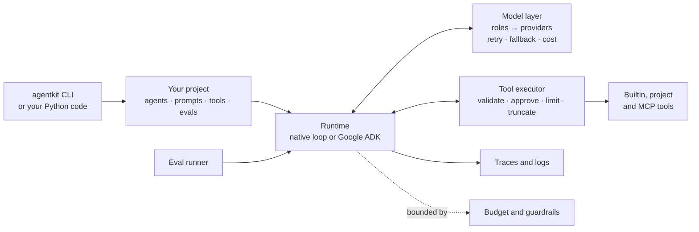

# agentkit

**A foundation for building AI agents that you can test, observe and bound.**

agentkit is a Python toolkit for the parts of an agent project that are the same every time: talking to models, running tools safely, evaluating changes, tracing what happened, and keeping cost under control. You describe an agent (a prompt, some tools, a model role) and the kit runs it, with limits, approvals and traces turned on from the first run.

> **Status: 0.1.0, pre-release.** The kit is complete and well tested against fake and local models. It has **not yet been exercised against the live Anthropic, OpenAI or Gemini APIs**; those paths are covered by unit tests with stubs and mocks only. See [Project status](#project-status) before depending on it.

## Why agentkit

- **Change the model by editing config.** Agent code asks for a model by role (`default`, `fast`, `reasoning`). Configuration maps the role to Anthropic, OpenAI, Gemini, any OpenAI-compatible endpoint, or a model running on your own machine.
- **Safe by default.** A tool is assumed to have side effects unless it says otherwise, side effects need approval, and every run has a budget for steps, tokens, cost and time.
- **Evals are part of the build.** A new project ships with an eval suite that passes with no API key. Changing a prompt, a tool or a model means re-running it and comparing.
- **Everything is traceable.** Each run gets an ID. Every model call and tool call is recorded, and logs carry the same ID.
- **Thin over clever.** The kit does not hide the underlying agent library, does not reimplement what a library already does well, and adds an abstraction only where two real agents needed it.

## What is in the box

| Area | What you get |
|---|---|
| Models | Anthropic, OpenAI, Gemini, OpenAI-compatible endpoints, local models (LM Studio, Ollama), and a scripted fake for tests. Retry, timeout, fallback chains and cost tracking for all of them. |
| Tools | A `@tool` decorator, a registry, 14 builtin tools, and tools from [MCP](https://modelcontextprotocol.io) servers. One executor applies validation, approval, timeouts, truncation and untrusted-content handling to every call. |
| Patterns | Single agent, fixed workflow, router, hand-off, planner and executor, parallel fan-out, evaluator and reviser loop, human in the loop. |
| Guardrails | Per-run budgets, loop and stall detection, an approval gate with resumable runs, input and output checks, redaction of secrets and personal data. |
| Evals | A dataset format, eleven graders, fixture-backed fake tools, record and replay of model responses, reports and run comparison. |
| Observability | JSON-lines traces, structured logs that carry the run ID, OpenTelemetry spans, and a terminal trace viewer. |
| Sessions | Conversation history, context-window trimming, and an interactive `agentkit chat`. |
| Runtimes | A small native tool-calling loop, and an adapter for Google ADK. |
| CLI | `new`, `run`, `chat`, `trace`, `eval`, `tools`, `models`, `config`, `doctor`. |

## Install

You need [uv](https://docs.astral.sh/uv/), which also installs Python 3.11 or newer for you.

```bash
git clone https://github.com/sagaryeole/agentkit agentkit
cd agentkit
uv sync
uv run agentkit doctor
```

`doctor` checks your configuration and tells you which credentials are missing. Nothing in the quick start needs any.

Optional extras add the SDKs for providers and integrations you use: `uv sync --extra anthropic`, `--extra adk`, `--extra mcp`.

To use agentkit from another project, add it as a dependency straight from the repository, for example `uv add "agentkit[anthropic] @ git+https://github.com/sagaryeole/agentkit"`. It is not published to PyPI.

## Quick start

```bash
uv run agentkit new my-agent
uv run agentkit eval run --project-dir my-agent
```

```
Suite my_agent_smoke (agent: my_agent)
  pass rate: 100.0% (3/3 attempts, 3 cases)
```

You now have a working project and a passing eval suite, without an API key. The starter cases script the model's replies, so they check that your prompt, tools and limits are wired together correctly.

Next, give it a real model. With [LM Studio](https://lmstudio.ai) or [Ollama](https://ollama.com) serving a model that supports tool calling, nothing leaves your machine:

```bash
uv run agentkit models list --local                       # the IDs your server offers
export MODEL_PROVIDER=local LOCAL_MODEL_ID=<one of those IDs>
uv run agentkit run my_agent "What is 17 times 23?" --project-dir my-agent
```

```
17 times 23 is 391.
[completed] 2 steps | 1 tool calls | 937 in / 44 out tokens | $0.0000 | 6.3s | trace: 2b7fc739...
```

Then look at what happened, and keep a conversation going:

```bash
uv run agentkit trace 2b7fc739 --project-dir my-agent
uv run agentkit chat my_agent --project-dir my-agent
```

The [Getting started guide](docs/getting-started.md) goes on from here: adding a tool, writing an eval, and moving to a hosted model.

## How it fits together



An agent is described, not programmed:

```python
from agentkit.runtime.spec import AgentSpec

agent = AgentSpec(
    name="my_agent",
    description="Answers questions, using tools for calculations and text statistics.",
    instructions="prompts/main.md",
    tools=["calculator", "word_count"],
)
```

[Concepts](docs/concepts.md) explains each part and how they connect.

## Documentation

| If you want to... | Read |
|---|---|
| Get running in ten minutes | [Getting started](docs/getting-started.md) |
| Understand the design | [Concepts](docs/concepts.md) |
| Configure the kit | [Configuration](docs/configuration.md) |
| Choose and configure models | [Models and providers](docs/models.md) |
| Write tools | [Writing tools](docs/writing-tools.md), [builtin tool reference](docs/reference/builtin-tools.md) |
| Pick an agent shape | [Patterns](docs/patterns.md) |
| Test your agent | [Writing evals](docs/writing-evals.md) |
| Bound cost and risk | [Guardrails](docs/guardrails.md), [Security](SECURITY.md) |
| See what a run did | [Observability](docs/observability.md) |
| Keep a conversation | [Sessions and chat](docs/sessions.md) |
| Embed it in your application | [Using agentkit as a library](docs/library.md) |
| Run on Google ADK | [ADK adapter](docs/adk.md) |
| Look up a command | [CLI reference](docs/reference/cli.md) |
| Fix a problem | [Troubleshooting and FAQ](docs/troubleshooting.md) |
| Contribute | [Contributing](CONTRIBUTING.md), [Development guide](docs/development.md) |

The [documentation index](docs/index.md) lists everything.

## Examples

Each example is a complete project with an eval suite that passes without an API key. Run one with `uv run agentkit eval run --project-dir examples/<name>`.

| Example | Shows |
|---|---|
| [`single_agent`](examples/single_agent) | One agent with one tool. |
| [`builtin_tools`](examples/builtin_tools) | An eval case for each builtin tool, with fixtures. |
| [`router`](examples/router) | A router handing requests to specialists. |
| [`workflow`](examples/workflow) | Fixed steps, each feeding the next. |
| [`planner`](examples/planner) | A planner writing a plan an executor carries out. |
| [`fan_out`](examples/fan_out) | Parallel workers and a merger. |
| [`revise_loop`](examples/revise_loop) | A writer and a reviewer, with bounded rounds. |
| [`human_in_loop`](examples/human_in_loop) | Approvals and asking the operator. |

## Project status

What is solid:

- The whole kit is covered by more than 300 unit tests that need no network and no keys, plus ruff, `mypy --strict`, and a dependency audit in CI.
- Everything has been run end to end against a local model served by LM Studio, and the Ollama path was run too.
- The Model Context Protocol integration has been run against a real local server.

What has not been verified, and why you should check before relying on it:

- **The Anthropic, OpenAI and Gemini providers** have been tested with stubs and mocks, never against the live APIs. The same goes for `agentkit doctor`'s checks of them and for context trimming against a Claude model. Run `uv run agentkit models test default` with your key as the first step, and `uv run pytest -m integration` to run the opt-in live tests.
- **Gemini** is reached through Google's OpenAI-compatible endpoint, not its native API.
- **The MCP HTTP transport** has not been run; the stdio transport has.
- **Everything live was run on one small local model**, which behaves differently from hosted ones.

Known limitations:

- Sessions, context trimming and hand-offs work on the native runtime only, not on the ADK adapter.
- There is no tool that executes model-written code, no OTLP trace exporter, and no adapters for LangGraph or the Claude Agent SDK.
- The kit is not a hosted service and has no UI, user management or vector store. That is by design.

See the [changelog](CHANGELOG.md) for the full list and for what counts as a breaking change.

## Contributing

Contributions are welcome: bug reports, documentation fixes, new providers, tools and graders. Read [CONTRIBUTING.md](CONTRIBUTING.md) first; it is short. By taking part you agree to follow the [Code of Conduct](CODE_OF_CONDUCT.md).

## Security

Agents read content they do not control and can take actions, so the kit assumes a model can be misled and limits what a misled agent can do. [SECURITY.md](SECURITY.md) describes the threat model and how to report a vulnerability.

## Licence

Apache-2.0. See [LICENSE](LICENSE).
