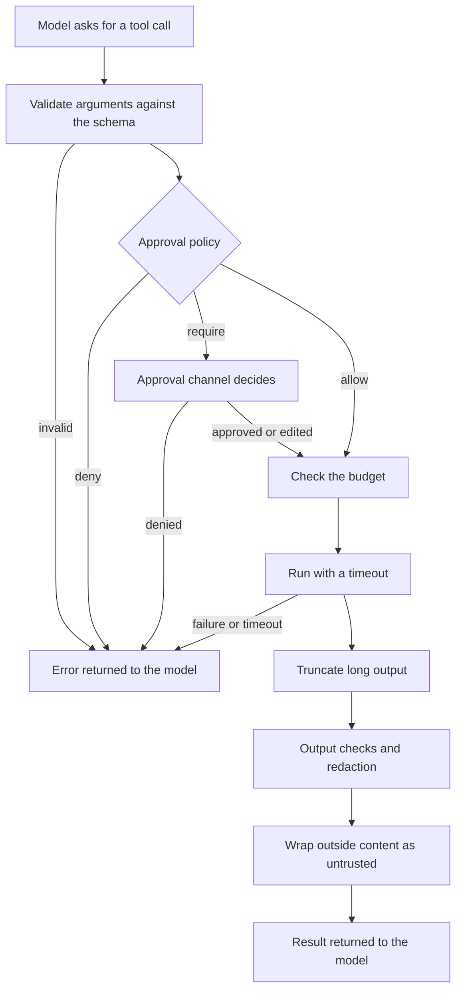

# Concepts

This page explains the parts of agentkit and how they connect. It describes how things work as they are built; the other pages say how to use them.

## The design in one paragraph

An agent is a prompt, a list of tools and a model role. Configuration decides which actual model a role means. A runtime runs the loop: ask the model, run the tools it asks for, repeat until it answers. Every tool call passes through one executor that enforces the rules, every run has a budget, and everything that happens is recorded in a trace. Evals run agents against fixed cases so a change can be judged by evidence.

The design follows a few rules that explain many choices you will meet:

1. **Thin over complete.** Small modules, functions before classes. No abstraction until two real agents need it.
2. **The agent library stays visible.** Adapters translate; they do not wrap. You can always get the library's own agent object.
3. **Configuration over code.** Model choice, limits, timeouts, retry and tool enablement live in config files, never in prompts or agent code.
4. **Safe by default.** Tools are assumed risky until declared otherwise. Risky calls need approval. Every run is bounded.
5. **Everything is traceable.**
6. **Evals are part of the build.**
7. **Workflow before agent, one agent before many.**

## The pieces

### Project

A project is a directory with this shape:

```
my-agent/
├── agentkit.yaml     configuration
├── agents/*.py       AgentSpec and pattern definitions
├── prompts/*.md      prompt files
├── tools/*.py        project tools
└── evals/*.yaml      eval suites and fixtures
```

`load_project` imports the Python files in `tools/` and `agents/` and collects what they define: every `Tool`, `AgentSpec`, pattern and Pydantic model. The project's tools join the builtin tools you enabled in the registry. Relative paths in the configuration (traces, eval results, the file workspace) are relative to the project directory.

### AgentSpec

The declarative description of one agent:

| Field | Meaning |
|---|---|
| `name` | Unique name. Also used by `agentkit run <name>` and by the per-agent provider switch. |
| `description` | What the agent is for. Routers show it to the model when choosing a route. |
| `instructions` | The prompt: either text, or the path of a prompt file such as `prompts/main.md`. |
| `variables` | Values for `{{name}}` placeholders in the instructions. |
| `model` | A model role (`default`, `fast`, `reasoning`) or an explicit catalogue key. |
| `tools` | Names of the tools this agent may use, and no others. |
| `sub_agents` | Names of agents it may hand off to. |
| `output_schema` | A Pydantic model; the final answer is parsed into it. |
| `limits` | Limits for this agent, replacing the global ones. |

An `AgentSpec` does not depend on any agent library. A runtime adapter turns it into something that runs.

### Model roles

Agent code never names a model. It names a role, and configuration maps roles to models:

```yaml
roles:
  default:   anthropic/claude-sonnet-5-5
  fast:      anthropic/claude-haiku-4-5
  reasoning: anthropic/claude-opus-5-5
  judge:     anthropic/claude-sonnet-5-5   # used by eval graders
```

Each role points at an entry in the model catalogue, which names a provider and a model ID. Changing providers means editing a role, not agent code. `MODEL_PROVIDER=local` remaps every role to a local model in one step. See [Models and providers](models.md).

### Model layer

`get_model("default")` returns a `Model`: a provider, plus an optional chain of fallbacks, plus behaviour that is the same for every provider and written once: filling in catalogue defaults, rejecting requests the model cannot handle, a timeout per call, retry with backoff for transient failures, falling back to the next model, and cost calculation. Providers only translate between the kit's common message types and one vendor's API.

### Tools and the executor

A tool is a Python function with a schema the model can see. Every call to every tool goes through one function, `execute_tool`, regardless of which runtime made it:



A tool failure never raises into the agent. The model always receives a result, and an error says what it can do next. Only two things stop a run from inside the executor: exceeding the budget, and an approval that has not been decided yet.

### Runtime and the run loop

A runtime adapter runs an `AgentSpec`. The native adapter is a small loop:

1. Check the budget. Build the request from the system prompt and the conversation so far.
2. Call the model.
3. If the model returned tool calls, run each through the executor, append the results, and go back to step 1.
4. If it returned an answer, run the final-answer checks, parse it if there is an output schema, and finish.

The loop also stops a run that repeats the same tool call or makes no progress. A run ends with one of these stop reasons:

| Stop reason | Meaning |
|---|---|
| `completed` | The agent produced an answer. |
| `budget_exceeded` | A limit was reached. The error names which one; any partial answer is returned. |
| `stalled` | The same tool call repeated too often, or consecutive steps produced neither a tool call nor an answer. |
| `awaiting_approval` | A tool call needs an approval nobody has given yet. The run can be stored and resumed. |
| `error` | Something failed: the model, a check, the output schema or the input. |

The result, `RunResult`, carries the output, stop reason, token and cost totals, step and tool counts, the full message transcript, the trace location, and any error.

### Guardrails

Guardrails are what make the loop safe to leave running. A **budget** counts steps, tool calls, tokens, cost and wall time and is checked before every model call and tool call. An **approval policy** decides which tool calls need a person. **Checks** run on the user's input, on tool output and on the final answer, and the shipped redactor removes secrets and personal data. See [Guardrails](guardrails.md).

### Patterns

A pattern is a way of arranging several agents. The kit ships the common ones: workflow, router, hand-off, planner and executor, fan-out, and a reviser loop. All of them are built from the same runtime, so every agent in a pattern runs as a nested run inside one trace and draws on one shared budget. See [Patterns](patterns.md).

### Observability

Each run has an ID. Each run, model call and tool call is a span, written to a JSON-lines file under `.agentkit/traces/` and mirrored to the OpenTelemetry API. Logs carry the same run ID. Secrets are redacted before anything is written. `agentkit trace` prints a run as a timeline. See [Observability](observability.md).

### Evals

An eval suite lists cases: an input, optional scripted tool results and model replies, and expectations. Graders check the outcome. Tools are replaced by fixtures and side effects are denied unless a case allows them, so evals are cheap and cannot change anything. Model responses can be recorded to a file and replayed, so most evals need no network. See [Writing evals](writing-evals.md).

### Sessions

A conversation is a series of ordinary runs. A session store keeps the history between them, and when the history grows close to the model's context window, the kit sends a trimmed copy rather than the whole thing. See [Sessions and chat](sessions.md).

## How the modules depend on each other

```
config ← models ← tools / guardrails / observability / memory ← runtime ← evals ← cli
```

Each package imports only from those to its left. Provider SDKs and agent libraries are imported only inside their own provider or adapter file, and are optional extras, so installing the kit does not pull them all in. The [development guide](development.md) describes the repository layout.

## What the kit deliberately does not do

- It is not a new agent runtime. Where an existing library already provides the loop, the kit adapts to it.
- It has no web UI, hosted service, vector database, prompt-management product, billing or user management.
- It does not model every provider feature. Provider-specific options pass through untouched in `ModelRequest.provider_options`, and the raw response is kept in `ModelResponse.raw`.

These are choices made in the [specification](../AGENTIC_FRAMEWORK_SPEC.md) the kit was built from, which is in the repository.
