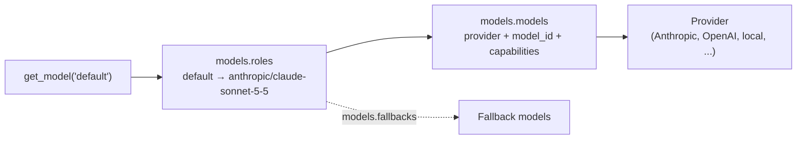

# Models and providers

Agent code asks for a model by role. Configuration maps the role to a provider and a model ID. This page explains how that works, how to run on a local model, and how to add models from other providers.

> **Verification status.** The local-model path has been run against real servers (LM Studio and Ollama). The Anthropic, OpenAI and Gemini providers are covered by unit tests using stubs and mocks, and have not yet been run against the live APIs. Start with `uv run agentkit models test <role>` when you first use one.

## Roles and the catalogue



`models.roles` maps a role name to a key in the catalogue, `models.models`. A catalogue entry says which provider to use and the model's ID. The shipped roles are:

| Role | Used for | Default |
|---|---|---|
| `default` | Most agents. | `anthropic/claude-sonnet-5-5` |
| `fast` | Cheap, quick tasks: routing, summarising context. | `anthropic/claude-haiku-4-5` |
| `reasoning` | Hard problems. | `anthropic/claude-opus-5-5` |
| `judge` | Eval graders. Set separately so the judge can differ from the agent. | `anthropic/claude-sonnet-5-5` |

You can add roles of your own. An `AgentSpec` names a role in its `model` field. Naming a catalogue key directly also works, though it ties the agent to one model and is discouraged.

Model IDs change over time. They are written only in `config/models.yaml` and in your own configuration, never in agent code. Check the IDs with your provider before relying on them.

Show what each role resolves to:

```bash
uv run agentkit models list
```

```
default    anthropic/claude-sonnet-5-5  [anthropic]
fast       anthropic/claude-haiku-4-5  [anthropic]
...
```

Make one real call to a role and see the tokens, cost and latency:

```bash
uv run agentkit models test fast
```

## Providers

| Provider | Needs | Notes |
|---|---|---|
| `anthropic` | `uv sync --extra anthropic` and `ANTHROPIC_API_KEY` | Uses the official SDK. Reasoning ("thinking") blocks are kept and sent back unchanged within a tool loop. |
| `openai` | `OPENAI_API_KEY` | OpenAI's chat-completions API. Sends `max_completion_tokens`. |
| `google` | `GOOGLE_API_KEY` or `GEMINI_API_KEY` | Gemini through Google's OpenAI-compatible endpoint, not its native API. |
| `openai_compat` | `api_base`, and a key variable named by `api_key_env` if the endpoint needs one | Any endpoint speaking the OpenAI chat-completions protocol: gateways, hosted open models, vLLM and similar. |
| `local` | A running LM Studio or Ollama server | A preset over `openai_compat` with discovery and clear start-up errors. |
| `fake` | Nothing | Scripted replies for tests and evals. No network. |

Each provider is one file under `src/agentkit/models/providers/`. Provider SDKs are optional extras, imported only when that provider is used, so installing the kit does not pull in all of them.

## Adding a model from another provider

Only the three Claude models and the local and fake entries ship in the catalogue, because model IDs change faster than this kit does. Add an entry for the one you want in your project's `agentkit.yaml`:

```yaml
models:
  models:
    openai/my-model:
      provider: openai              # reads OPENAI_API_KEY
      model_id: my-model            # exactly as OpenAI lists it
    google/my-gemini:
      provider: google              # reads GOOGLE_API_KEY or GEMINI_API_KEY
      model_id: my-gemini
    gateway/my-model:
      provider: openai_compat       # any OpenAI-compatible endpoint
      model_id: my-model
      api_base: https://gateway.example.com/v1
      api_key_env: GATEWAY_API_KEY

  roles:
    default: openai/my-model        # point a role at it
```

Add a price to get cost tracking, in the same file:

```yaml
pricing:
  openai/my-model: { input: 2.00, output: 8.00 }     # US dollars per million tokens
```

Check it end to end with `uv run agentkit models test default`, and see that the endpoint is reachable and knows the ID with `uv run agentkit doctor`.

## Capabilities

Models differ in what they support, and the kit checks a request against the model's declared capabilities before sending it, so you get a clear message instead of an obscure provider error.

| Capability | Default | Effect when `false` |
|---|---|---|
| `tools` | `true` | An agent with tools fails at start-up with a clear message. It never runs silently without its tools. |
| `forced_tool_choice` | `true` | A request that forces a particular tool call is refused. Current Claude Sonnet and Opus models reject forced tool choice, so they are declared `false`. |
| `structured_output` | `true` | The kit falls back to prompting for JSON, validating it against the schema, and retrying a few times. |
| `vision` | `true` | Image input is refused. |
| `parallel_tool_calls`, `streaming`, `prompt_caching` | provider's | Informational. |
| `context_window` | provider's | Used to decide when to trim conversation history. |
| `max_output_tokens` | provider's | A request asking for more is refused. |

Override any of them for a catalogue entry under `capabilities`. A model's real limits are the thing to declare; the kit takes your word for it.

## Retry, timeout and fallback

The same behaviour applies to every provider, around it, in one place:

- **Timeout.** `timeouts.model_call_seconds` per call (`models.local.request_timeout_seconds` for local models).
- **Retry.** Rate limits, timeouts and server errors are retried up to `retry.max_attempts` times with exponential backoff and jitter. Client errors such as an invalid request are never retried.
- **Fallback.** If a model still fails after its retries, the next model in `models.fallbacks` for that role is tried:

```yaml
models:
  fallbacks:
    default: [openai/my-model]
```

- **Cost.** Each response's `usage.cost_usd` is computed from the `pricing` entry for the model that answered. Cache reads are priced at `cached_input` when set. Cache writes are billed at the plain input rate, so cost is slightly understated when you use prompt caching.

Streaming is thinner than a plain call: it can fall back before the first event arrives, but is not retried and has no per-call timeout.

## Local models

Any agent can run on a model served on your own machine, with no cloud account and no key. Both LM Studio and Ollama expose an OpenAI-compatible API, and the `local` provider is a preset over the `openai_compat` provider.

| Server | Default base URL |
|---|---|
| LM Studio | `http://127.0.0.1:1234/v1` |
| Ollama | `http://127.0.0.1:11434/v1` |

Any other server that speaks the same protocol (llama.cpp's server, vLLM) works with `models.local.server: custom` and a base URL.

### Switching to a local model

```bash
uv run agentkit models list --local                   # IDs the server offers right now
export MODEL_PROVIDER=local                           # every hosted role becomes the local model
export LOCAL_MODEL_ID=<id from that list>
uv run agentkit run my_agent "..." --project-dir my-agent
```

`MODEL_PROVIDER=local` remaps every role whose model is not local to the catalogue entry `local/default`. The model ID comes from `LOCAL_MODEL_ID`, or from `model_id` of that entry.

To move one agent only, name it: for an agent called `triage`, `TRIAGE_MODEL_PROVIDER=local`. It overrides `MODEL_PROVIDER` in either direction, so with `MODEL_PROVIDER=local` set, `TRIAGE_MODEL_PROVIDER=anthropic` keeps `triage` on its hosted model. That lets a multi-agent system mix local and hosted models.

| Variable | Meaning |
|---|---|
| `MODEL_PROVIDER` | `local` switches every agent. |
| `<AGENT_NAME>_MODEL_PROVIDER` | Switches one agent. |
| `LOCAL_API_BASE` | Base URL, including the port and `/v1`. |
| `LOCAL_MODEL_ID` | The model ID as the server reports it. |
| `LOCAL_API_KEY` | Optional. A placeholder is sent when unset. |

### What the kit checks for you

Before the first call, the local provider asks the server for its model list. A failure names the actual cause:

- **The server is not running.** It tells you how to start LM Studio or Ollama.
- **The base URL is wrong**, for example missing the port or `/v1`.
- **The model is not loaded.** It lists the IDs the server does offer.

`uv run agentkit doctor` runs the same checks without a run.

### Declare what your model supports

Local models differ widely in tool calling, structured output and context size, so the kit assumes little: tools on, structured output off, vision off, an 8,192-token context window. Edit the `local/default` entry for your model:

```yaml
models:
  models:
    local/default:
      provider: local
      model_id: ""                 # or set LOCAL_MODEL_ID
      capabilities:
        tools: true
        structured_output: false
        vision: false
        context_window: 32768      # what you actually loaded the model with
```

A model without native structured output still works with agents that have an `output_schema`: the kit prompts for JSON and validates it. A model without tool calling cannot run an agent that has tools. A small context window means conversation history is trimmed earlier.

### Data stays on the machine

A fallback from a local model to a hosted one would send your data off the machine, so it never happens unless you set it up. When the provider switch is `local`, hosted fallbacks are dropped. A fallback chain that goes local to hosted exists only if you list it on a role that you have mapped to a local model.

### Using local models for evals

Run the same eval suite on a hosted model and on a local model, then compare the two runs:

```bash
uv run agentkit eval run --project-dir my-agent                 # hosted
MODEL_PROVIDER=local LOCAL_MODEL_ID=<id> uv run agentkit eval run --project-dir my-agent
uv run agentkit eval compare <hosted run id> <local run id> --project-dir my-agent
```

That is the supported way to decide whether a local model is good enough for an agent. The judge model is set separately and can stay hosted.

## Writing a provider

A provider is an object with a `name`, `capabilities`, and three async methods:

```python
class ModelProvider(Protocol):
    name: str
    capabilities: Capabilities

    async def generate(self, req: ModelRequest) -> ModelResponse: ...
    def stream(self, req: ModelRequest) -> AsyncIterator[StreamEvent]: ...
    async def count_tokens(self, req: ModelRequest) -> int: ...
```

It should translate between the kit's types (`Message`, `ToolSpec`, `ModelRequest`, `ModelResponse`, `Usage`) and one API, convert every failure into a `ModelError` with `retryable` set correctly, and do no retrying of its own, since the `Model` wrapper does that. A provider may also define `async def ping(self) -> str`, a free check that the service answers and accepts the credentials, which `agentkit doctor` calls.

Register it in `build_provider` in `src/agentkit/models/registry.py`, import its SDK only inside its own file, and add it as an optional extra in `pyproject.toml`. The [development guide](development.md#adding-a-provider) lists the rest, and `src/agentkit/models/providers/fake.py` is the smallest example. Provider-specific features that are not worth modelling in the common types can be reached through `ModelRequest.provider_options`, which is passed to the provider untouched, and `ModelResponse.raw`, which holds the original response.
